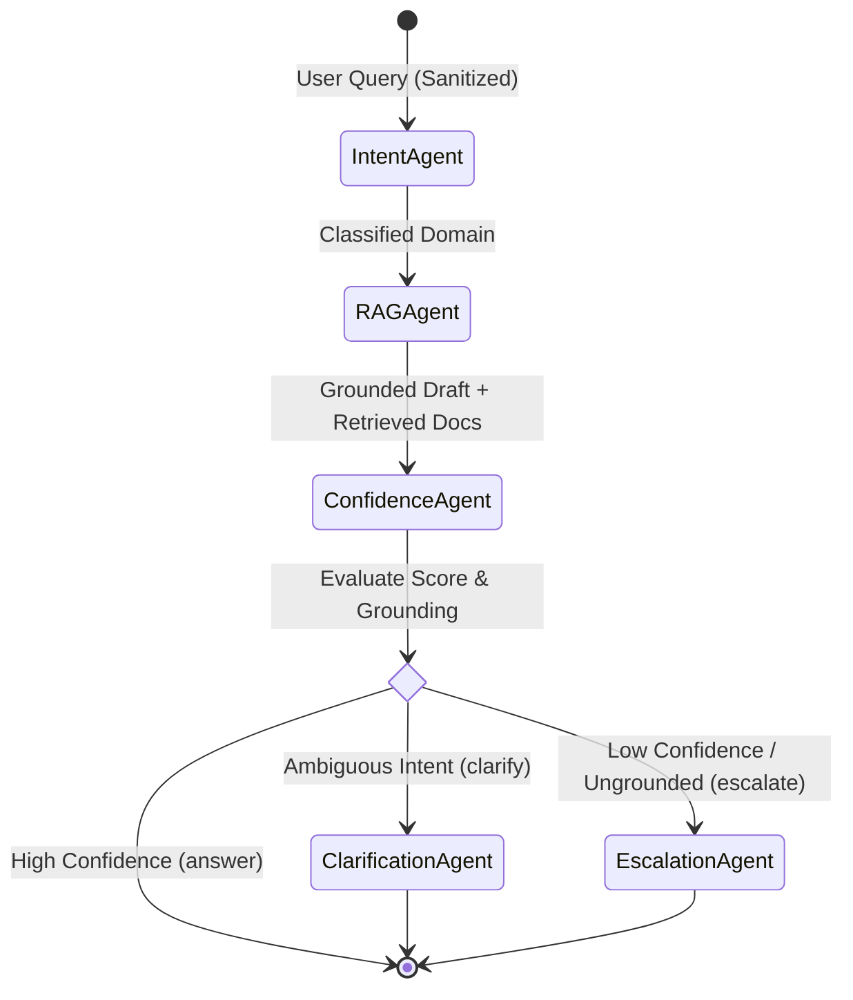

# Multi-Agent Support Orchestrator

A stateful, multi-agent Retrieval-Augmented Generation (RAG) system built with **LangGraph**, **ChromaDB**, **Groq**, and **LangSmith**.

Most LLM-based support bots rely on unbounded prompting, which makes them prone to hallucination, prompt injection, and unpredictable routing. This project decouples **language generation** from **control flow**: LLMs handle classification, synthesis, and scoring, while a deterministic Python state machine governs every transition, guardrail, and escalation path.

---

## Core Tech Stack

| Layer | Technology | Role |
| :--- | :--- | :--- |
| **Orchestration** | LangGraph | Stateful directed graph execution and conditional routing |
| **Inference** | Groq (`openai/gpt-oss-20b`) | Low-latency LLM execution across chained multi-agent calls |
| **Retrieval** | ChromaDB + HuggingFace Embeddings | Local persistent vector store for grounded document lookup |
| **Observability** | LangSmith | End-to-end trace logging, latency profiling, and retrieval auditing |
| **Interface** | Streamlit | Interactive frontend for query testing and confidence inspection |

---

## Architecture & Execution Flow

Every user query enters a strongly typed state object (`SupportState`) and passes through a bounded execution graph defined in `core/graph.py`. If retrieved context is insufficient or confidence falls below the threshold, the graph fails closed by escalating to human support rather than fabricating an answer.



### Node Responsibilities

1. **Input Sanitization (`agents/injection_guard.py`)**  
   Inspects incoming queries for prompt-injection patterns and sanitizes user context before it reaches the graph.
2. **Intent Classification (`agents/intent_agent.py`)**  
   Categorizes the incoming issue into a structured support domain to guide downstream retrieval.
3. **Grounded Retrieval (`agents/rag_agent.py`, `agents/grounding_guard.py`)**  
   Queries the persistent ChromaDB store via `rag/retriever.py`, synthesizes an answer strictly from retrieved Markdown chunks, and verifies that claims are supported by source context.
4. **Confidence & Routing (`agents/confidence_agent.py`)**  
   Scores the generated response and assigns a deterministic routing action (`answer`, `clarify`, or `escalate`).
5. **Fallback Handlers (`agents/clarification_agent.py`, `agents/escalation_agent.py`)**  
   Requests targeted follow-up details for ambiguous queries or generates a human handoff ticket when the knowledge base lacks coverage.

---

## Engineering Decisions & Trade-offs

* **Deterministic State Graph over Autonomous Agent Loops**  
  Open-ended ReAct loops can burn tokens and hang in retry cycles. Modeling support triage as an explicit directed graph guarantees bounded execution steps, predictable latency, and straightforward unit testing.
* **Fail-Closed Grounding Policy**  
  When a query falls outside the indexed knowledge base, the RAG node explicitly declines to speculate, driving the confidence score to `0.0` and triggering the `escalate` edge. In production support environments, a safe escalation is strictly preferable to a fluent hallucination.
* **Low-Latency Inference for Chained Calls**  
  Because a single user turn invokes 3–4 sequential LLM calls (Intent, RAG synthesis, Grounding, Confidence), standard API latency compounds quickly. Running inference on Groq keeps end-to-end multi-agent execution around ~2–3 seconds per turn.

---

## Observability & Tracing

The pipeline is instrumented with **LangSmith** (`LANGCHAIN_TRACING_V2=true`). Every execution captures:
* Node-by-node state transitions and conditional edge decisions.
* Exact documents returned by `VectorStoreRetriever` alongside retrieval latency.
* Per-call token consumption and model latency for bottleneck analysis.

> **Tip:** Add a screenshot of your LangSmith execution trace here (e.g., ``) so reviewers can immediately see the multi-agent waterfall and retrieval audit.

---

## Repository Structure

```text
.
├── agents/                     # Modular agent nodes and safety guardrails
│   ├── intent_agent.py
│   ├── rag_agent.py
│   ├── confidence_agent.py
│   ├── clarification_agent.py
│   ├── escalation_agent.py
│   ├── grounding_guard.py
│   └── injection_guard.py
├── core/                       # LangGraph topology and shared state schema
│   ├── graph.py
│   └── state.py
├── rag/                        # Vector store retriever logic
│   └── retriever.py
├── data/docs/                  # Source Markdown knowledge base
├── chroma_db/                  # Persistent Chroma vector database
├── notebooks/                  # Data ingestion and vector index creation
│   ├── DataCreation.ipynb
│   └── VectorCreation.ipynb
├── evaluation/                 # Evaluation scripts and datasets
├── evaluation.ipynb            # Retrieval and routing metrics notebook
├── config.py                   # Centralized LLM and path configuration
├── main.py                     # Streamlit application entry point
└── requirements.txt
```

---

## Local Setup & Quickstart

### 1. Clone and Create a Virtual Environment
```bash
git clone "https://github.com/prank-it37/multi-agent-support-orchestrator.git"
cd Langgraph-Customer-Support-Multi-Agent-main
python -m venv venv
```

Activate the environment:
```bash
# Windows (PowerShell)
.\venv\Scripts\Activate.ps1

# macOS / Linux
source venv/bin/activate
```

### 2. Install Dependencies
```bash
pip install -r requirements.txt
```

### 3. Configure Environment Variables
Create a `.env` file in the root directory:
```env
GROQ_API_KEY="your_groq_api_key"
LANGCHAIN_TRACING_V2="true"
LANGCHAIN_API_KEY="your_langsmith_api_key"
```

### 4. Build the Vector Index (Optional)
If you add or modify Markdown files in `data/docs/`, rebuild the local ChromaDB index by running all cells in `notebooks/VectorCreation.ipynb`.

### 5. Launch the Application
```bash
streamlit run main.py
```

---

## Evaluation

System reliability is measured in `evaluation.ipynb` across retrieval quality and routing safety:
* **Retrieval Quality:** Recall@K against labeled support queries.
* **Routing Accuracy:** Precision of `answer` vs. `clarify` vs. `escalate` decisions.
* **Safety Metrics:** Hallucination rate and missed-escalation rate on out-of-domain queries.

---

## Planned Improvements

* **Domain Expansion:** Swap the sample knowledge base for Cloud/DevOps troubleshooting runbooks (IAM, Kubernetes, billing alerts).
* **Model-Agnostic Fallback:** Add automatic provider failover in `config.py` (e.g., Groq primary with Gemini/Vertex AI fallback) to handle upstream `503` or rate-limit spikes.
* **Automated CI Regression Suite:** Run LangSmith dataset evaluations on pull requests to catch prompt or retrieval regressions before deployment.